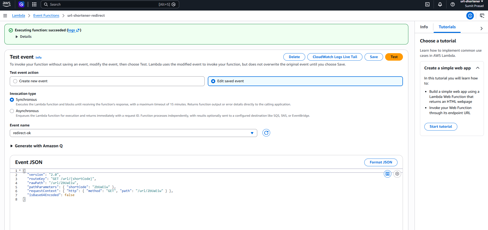
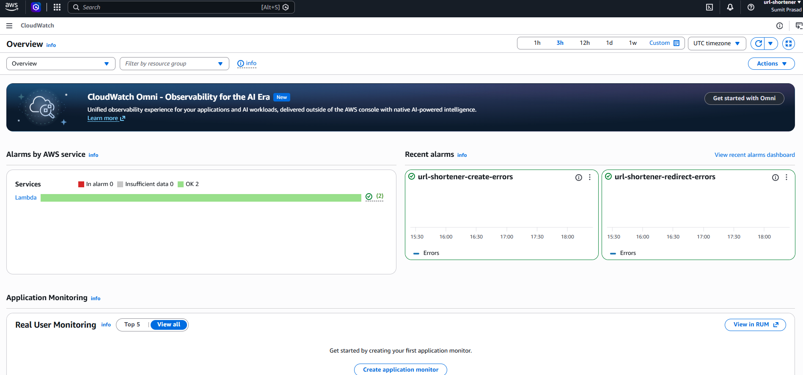
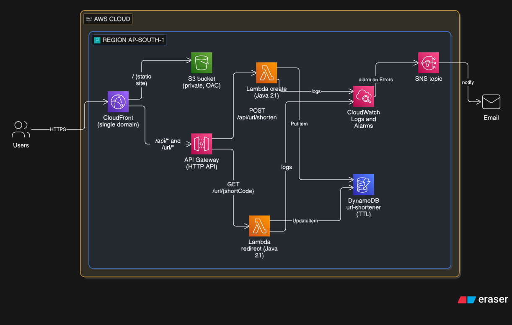

# Serverless URL Shortener on AWS

A URL shortener built on AWS serverless services: **CloudFront, S3, API Gateway (HTTP API), Lambda (Java 21), and DynamoDB**, with CloudWatch logging and SNS email alarms.

This is the serverless re-implementation of my earlier Spring Boot + MongoDB + Docker project, [url-shortener](https://github.com/prasadsumit/url-shortener). I built the same product on two different architectures to understand the trade-offs between a container-based service and a managed, pay-per-request stack.

> **Status:** Part A (manual deployment through the AWS Console) is complete. Part B (the same stack as Terraform) is in progress. See the [roadmap](#status-and-roadmap).

| | |
|---|---|
| **Live demo** | [https://DXXXXXXXX.cloudfront.net](https://d13ta49pijxb04.cloudfront.net/) *(note that it might be torn down to avoid cost)* |
| **Region** | `ap-south-1` (Mumbai) |
| **Language** | Java 21 (plain Lambda handlers, no Spring) |
| **Related project** | [Spring Boot + Docker + MongoDB version](https://github.com/prasadsumit/url-shortener) |

## Screenshots

| Frontend | API Test | CloudWatch alarm |
|---|---|---|
|  |  |   |

## Architecture



*Diagram source: [`docs/architecture.eraser`](docs/architecture.eraser) (paste into [eraser.io](https://www.eraser.io)) to use the same. *

| Component | Purpose |
|---|---|
| **CloudFront** | Single public domain. Routes `/` to S3 and `/api/*`, `/url/*` to API Gateway, so no CORS configuration is needed. |
| **S3** (private bucket) | Hosts the static frontend (`index.html`). Only CloudFront can read it, via Origin Access Control (OAC). |
| **API Gateway (HTTP API)** | Two routes, `POST /api/url/shorten` and `GET /url/{shortCode}`, with default route throttling (10 req/s, burst 20). |
| **Lambda `create`** | Validates the URL, generates a 7-character code, and writes it to DynamoDB with a conditional put. |
| **Lambda `redirect`** | Looks up the code, checks expiry, increments the click count, and returns a `302`. |
| **DynamoDB** (on-demand) | Stores URL mappings. A TTL attribute removes expired items. |
| **IAM** | One execution role per function with a single DynamoDB action on a single table. |
| **CloudWatch + SNS** | Log groups with 1-week retention, plus an `Errors` alarm per function that emails me through an SNS topic. |


## API

### `POST /api/url/shorten`

```json
{ "originalUrl": "https://www.example.com/some/long/path", "expiryHours": 24 }
```

| Status | Body |
|---|---|
| `200` | The short code as plain text, for example `aB3xK9q` |
| `400` | Missing body, invalid JSON, invalid or non-http(s) URL, URL over 2048 characters, or `expiryHours` out of range |
| `500` | Could not generate a unique code after 5 attempts |

### `GET /url/{shortCode}`

| Status | Result |
|---|---|
| `302` | `Location` header set to the original URL |
| `404` | Code does not exist or has expired |

## Data model

Single DynamoDB table `url-shortener`, partition key `shortCode` (String), on-demand capacity, TTL on `expiresAt`.

| Attribute | Type | Notes |
|---|---|---|
| `shortCode` | String | Partition key |
| `originalUrl` | String | Validated `http`/`https` URL |
| `createdAt` | Number | Epoch seconds |
| `expiresAt` | Number | Epoch seconds, optional, used by TTL |
| `clickCount` | Number | Incremented atomically on each redirect |

## Design decisions and trade-offs

- **DynamoDB instead of MongoDB.** The access pattern is a pure key lookup, which suits a key-value store. On-demand capacity means no idle cost, and TTL replaces the Mongo TTL index from the earlier version.
- **Plain Java handlers instead of Spring Boot.** Spring's startup time makes Lambda cold starts slow. Plain handlers with the AWS SDK v2 and the lightweight URL-connection HTTP client keep the jar small. No Lambda layers are needed because dependencies are bundled into one jar used by both functions.
- **Collision-safe writes.** `create` uses a conditional `PutItem` (`attribute_not_exists`) and retries on collision, so an existing code is never overwritten.
- **Expiry is checked in code, not only by TTL.** DynamoDB deletes expired items lazily, sometimes days later, so `redirect` also compares `expiresAt` to the current time.
- **One `UpdateItem` per redirect.** A single conditional update does the lookup, the expiry check, and the atomic click increment, which avoids a read followed by a write.
- **Redirects are not cached at CloudFront.** Caching would be faster and cheaper but would stop clicks from being counted. The `/api/*` and `/url/*` behaviors use the `CachingDisabled` policy.
- **Single CloudFront domain.** The site and the API share an origin from the browser's point of view, so CORS is unnecessary. The `AllViewerExceptHostHeader` origin request policy is required because API Gateway rejects requests with a foreign `Host` header.
- **Throttling is per route, not per IP.** The earlier version limited requests per client IP with Bucket4j. API Gateway HTTP APIs offer route-level throttling only. Per-client limits would need AWS WAF, which adds a monthly cost.
- **HTTP API instead of REST API.** Simpler and cheaper, and sufficient for two proxy routes.

## Security

- The S3 bucket blocks all public access; CloudFront reads it through OAC.
- Each Lambda has its own IAM role: `create` can only `dynamodb:PutItem`, `redirect` can only `dynamodb:UpdateItem`, both on this one table, plus basic CloudWatch Logs permissions.
- No credentials in code or configuration; functions use their execution role.
- Only `http` and `https` URLs are accepted, with a length limit, so the redirect function only serves validated targets.
- API throttling limits abuse and runaway cost.

## Observability

- CloudWatch Log groups for both functions with 1-week retention.
- A CloudWatch alarm on each function's `Errors` metric (Sum of 1 or more in 5 minutes) notifies an SNS topic with an email subscription.

## Cost

The design targets close to $0 at hobby traffic: Lambda, DynamoDB on-demand, API Gateway, S3 and CloudFront all bill by usage and have free allowances. A budget alert is configured in the AWS account. 

## Project structure

```
.
├── pom.xml
├── frontend/
│   └── index.html
├── src/main/java/com/example/shortener/
│   ├── CreateHandler.java
│   ├── RedirectHandler.java
│   ├── Db.java
│   ├── Responses.java
│   └── CodeGenerator.java
├── terraform/                    # work in progress (Part B)
└── docs/
    ├── architecture.png
    ├── architecture.eraser
    └── screenshots/
```

## Status and roadmap

**Done (Part A, manual build):**

- [x] DynamoDB table with TTL
- [x] Least-privilege IAM roles, one per function
- [x] Java 21 Lambda functions (`create`, `redirect`)
- [x] API Gateway HTTP API with throttling
- [x] Private S3 frontend served through CloudFront with OAC
- [x] CloudFront routing of site and API on a single domain
- [x] CloudWatch log retention and error alarms with SNS email notifications

**In progress:**

- [ ] **Part B: Terraform.** The same stack as infrastructure as code (DynamoDB, IAM, Lambda, API Gateway, S3, CloudFront, CloudWatch, SNS), so it can be created and destroyed with one command.

**Planned:**

- [ ] Lambda SnapStart, with a published version and a `live` alias, to reduce Java cold starts (and measure before and after)
- [ ] Custom domain with an ACM certificate and Cloudflare DNS
- [ ] CI/CD with GitHub Actions, using OIDC to assume an AWS role instead of stored access keys

## Known limitations

- No authentication, link management, or deletion endpoint.
- Rate limiting is per route, not per client.
- Without SnapStart, the first request after idle time is slower because of the Java cold start.
- Expired items can linger in the table for a while before TTL removes them (they are never served).
- The demo environment may be offline, since it is torn down between work sessions to avoid cost.

## Related project: container-based version

[`url-shortener`](https://github.com/prasadsumit/url-shortener) is the original implementation of the same product as a Spring Boot application with MongoDB, Docker, Bucket4j rate limiting, and in-memory caching.

| | [Container version](https://github.com/prasadsumit/url-shortener) | This project (serverless) |
|---|---|---|
| Compute | Spring Boot in a Docker container | Two Java 21 Lambda functions |
| Database | MongoDB | DynamoDB |
| Expiry | MongoDB TTL | DynamoDB TTL plus a check in code |
| Rate limiting | Bucket4j, per client IP | API Gateway throttling, per route |
| Caching | In-memory cache | None on redirects (keeps click counts accurate) |
| Scaling | Manual or container-based | Automatic, per request |
| Idle cost | A running server | Close to zero |
| Deployment | Docker image | Console build today, Terraform in progress |
