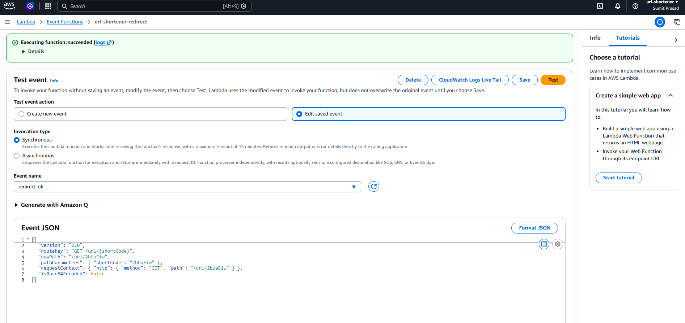
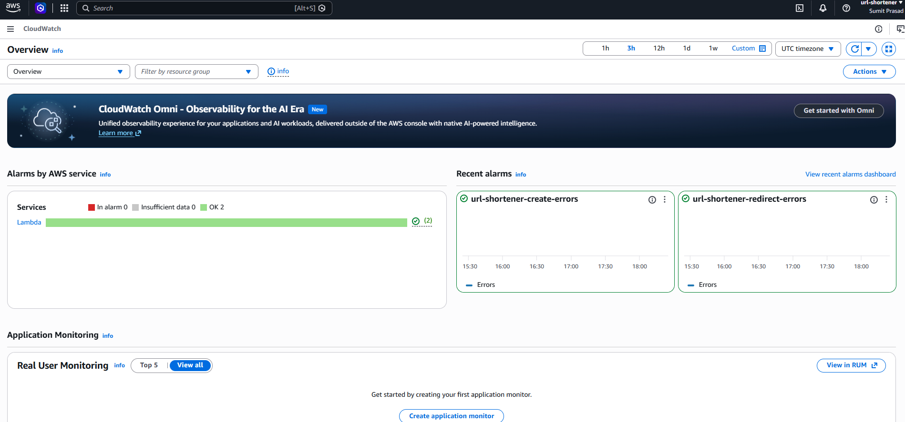
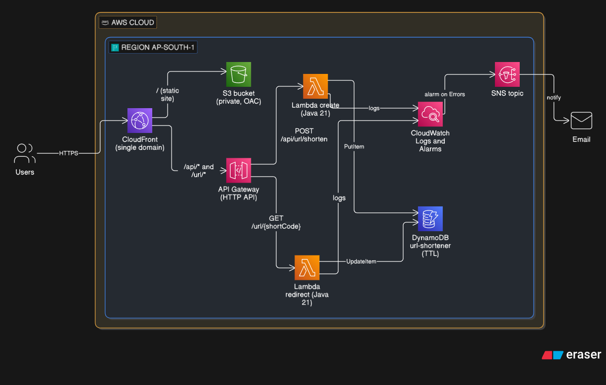

# Serverless URL shortener on AWS

A URL shortener built with CloudFront, S3, API Gateway (HTTP API), Lambda (Java 21), and DynamoDB. It uses CloudWatch for logging and SNS for email alarms.

I rebuilt my earlier Spring Boot + MongoDB + Docker project, [url-shortener](https://github.com/prasadsumit/url-shortener), on AWS serverless services to compare a container-based service with a managed, pay-per-request stack.

Part A, manual deployment through the AWS Console, is complete. Part B, the same stack in Terraform, is in progress. See the [roadmap](#status-and-roadmap).

| | |
|---|---|
| Live demo | [https://DXXXXXXXX.cloudfront.net](https://d13ta49pijxb04.cloudfront.net/) (may be offline to avoid cost) |
| Region | `ap-south-1` (Mumbai) |
| Language | Java 21 (plain Lambda handlers, no Spring) |
| Related project | [Spring Boot + Docker + MongoDB version](https://github.com/prasadsumit/url-shortener) |

## Screenshots

| Frontend | API test | CloudWatch alarm |
|---|---|---|
|  |  |   |

## Architecture



To edit the diagram, paste [`docs/architecture.eraser`](docs/architecture.eraser) into [eraser.io](https://www.eraser.io).

| Component | Purpose |
|---|---|
| CloudFront | Single public domain. Routes `/` to S3 and `/api/*`, `/url/*` to API Gateway, so no CORS configuration is needed. |
| S3 (private bucket) | Hosts the static frontend (`index.html`). Only CloudFront can read it, via Origin Access Control (OAC). |
| API Gateway (HTTP API) | Two routes, `POST /api/url/shorten` and `GET /url/{shortCode}`, with default route throttling (10 req/s, burst 20). |
| Lambda `create` | Validates the URL, generates a 7-character code, and writes it to DynamoDB with a conditional put. |
| Lambda `redirect` | Looks up the code, checks expiry, increments the click count, and returns a `302`. |
| DynamoDB (on-demand) | Stores URL mappings. A TTL attribute removes expired items. |
| IAM | One execution role per function with a single DynamoDB action on a single table. |
| CloudWatch + SNS | Log groups with 1-week retention, plus an `Errors` alarm per function that emails me through an SNS topic. |


## API

### `POST /api/url/shorten`

```json
{ "originalUrl": "https://www.example.com/some/long/path", "expiryHours": 24 }
```

| Status | Body |
|---|---|
| `200` | The short code as plain text, for example `aB3xK9q` |
| `400` | Missing body, invalid JSON, invalid or non-http(s) URL, URL over 2048 characters, or `expiryHours` out of range |
| `500` | Could not generate a unique code after 5 attempts |

### `GET /url/{shortCode}`

| Status | Result |
|---|---|
| `302` | `Location` header set to the original URL |
| `404` | Code does not exist or has expired |

## Data model

The DynamoDB table `url-shortener` uses `shortCode` (String) as its partition key, with on-demand capacity and TTL on `expiresAt`.

| Attribute | Type | Notes |
|---|---|---|
| `shortCode` | String | Partition key |
| `originalUrl` | String | Validated `http`/`https` URL |
| `createdAt` | Number | Epoch seconds |
| `expiresAt` | Number | Epoch seconds, optional, used by TTL |
| `clickCount` | Number | Incremented atomically on each redirect |

## Design decisions and trade-offs

- DynamoDB suits the key-based lookups this app needs. On-demand capacity means no idle cost, and TTL replaces the Mongo TTL index from the earlier version.
- Plain Java handlers avoid Spring Boot's startup overhead during Lambda cold starts. The AWS SDK v2 and lightweight URL-connection HTTP client keep the jar small. Both functions use the same jar with bundled dependencies, so they need no Lambda layers.
- `create` uses a conditional `PutItem` (`attribute_not_exists`) and retries on collision, so an existing code is never overwritten.
- DynamoDB can take days to delete expired items. `redirect` also compares `expiresAt` to the current time to avoid serving them.
- Each redirect uses one conditional `UpdateItem` for the lookup, expiry check, and atomic click increment. This avoids a separate read followed by a write.
- CloudFront does not cache redirects because cached responses would bypass click counting. Caching would be faster and cheaper, but the `/api/*` and `/url/*` behaviors use the `CachingDisabled` policy to keep counts accurate.
- The site and API share a CloudFront domain, so the browser sees one origin and needs no CORS configuration. The `AllViewerExceptHostHeader` origin request policy is required because API Gateway rejects requests with a foreign `Host` header.
- API Gateway HTTP APIs throttle per route. The earlier version used Bucket4j to limit requests per client IP. Per-client limits would need AWS WAF, which adds a monthly cost.
- HTTP API is simpler and cheaper than REST API and is sufficient for the two proxy routes.

## Security

- The S3 bucket blocks all public access; CloudFront reads it through OAC.
- Each Lambda has its own IAM role. On this table, `create` can only use `dynamodb:PutItem`, and `redirect` can only use `dynamodb:UpdateItem`. Both roles also have basic CloudWatch Logs permissions.
- Functions use their execution roles. There are no credentials in code or configuration.
- The app accepts only `http` and `https` URLs and enforces a length limit, so the redirect function serves only validated targets.
- API throttling limits abuse and runaway cost.

## Observability

- Both functions have CloudWatch log groups with 1-week retention.
- A CloudWatch alarm on each function's `Errors` metric notifies an SNS topic with an email subscription when the Sum is 1 or more in 5 minutes.

## Cost

At hobby traffic levels, the target cost is close to $0. Lambda, DynamoDB on-demand, API Gateway, S3, and CloudFront bill by usage and have free allowances. The AWS account has a budget alert configured.

## Project structure

```
.
├── pom.xml
├── frontend/
│   └── index.html
├── src/main/java/com/example/shortener/
│   ├── CreateHandler.java
│   ├── RedirectHandler.java
│   ├── Db.java
│   ├── Responses.java
│   └── CodeGenerator.java
├── terraform/                    # work in progress (Part B)
└── docs/
    ├── architecture.png
    ├── architecture.eraser
    └── screenshots/
```

## Known limitations

- No authentication, link management, or deletion endpoint.
- Rate limiting is per route, not per client.
- Without SnapStart, the first request after idle time is slower because of the Java cold start.
- Expired items can remain in the table until TTL removes them, but the app never serves them.
- I tear down the demo environment between work sessions to avoid cost, so it may be offline.

## Related project: container-based version

[`url-shortener`](https://github.com/prasadsumit/url-shortener) is the original implementation of the same product as a Spring Boot application with MongoDB, Docker, Bucket4j rate limiting, and in-memory caching.

| | [Container version](https://github.com/prasadsumit/url-shortener) | This project (serverless) |
|---|---|---|
| Compute | Spring Boot in a Docker container | Two Java 21 Lambda functions |
| Database | MongoDB | DynamoDB |
| Expiry | MongoDB TTL | DynamoDB TTL plus a check in code |
| Rate limiting | Bucket4j, per client IP | API Gateway throttling, per route |
| Caching | In-memory cache | None on redirects (keeps click counts accurate) |
| Scaling | Manual or container-based | Automatic, per request |
| Idle cost | A running server | Close to zero |
| Deployment | Docker image | Console build today, Terraform in progress |
